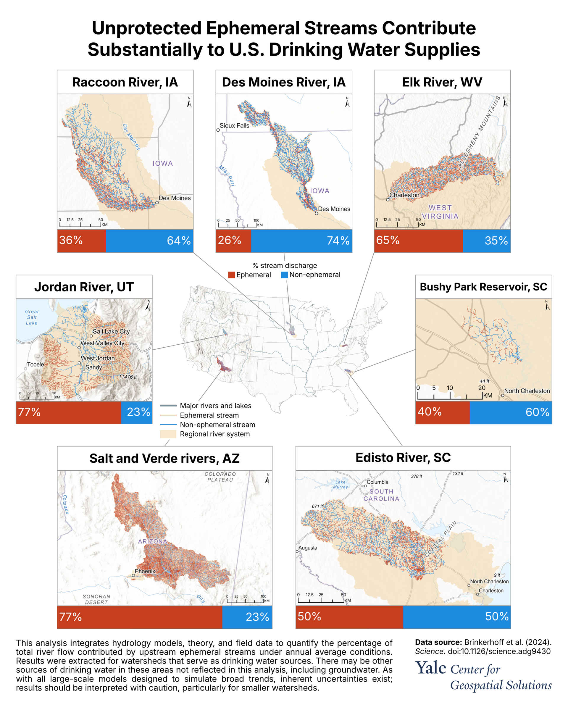
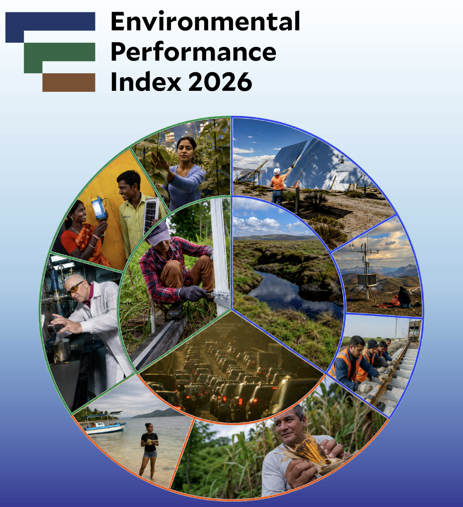
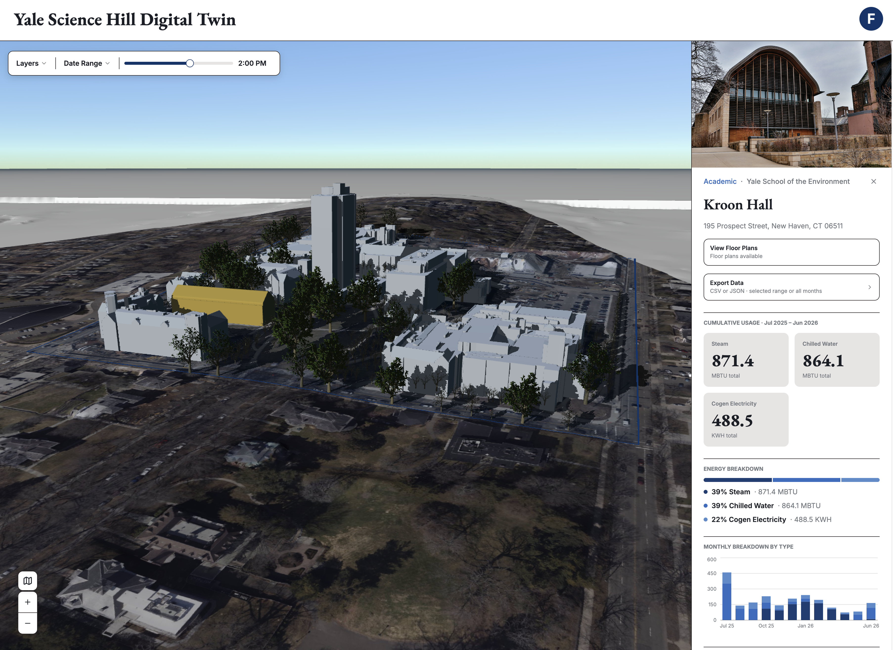
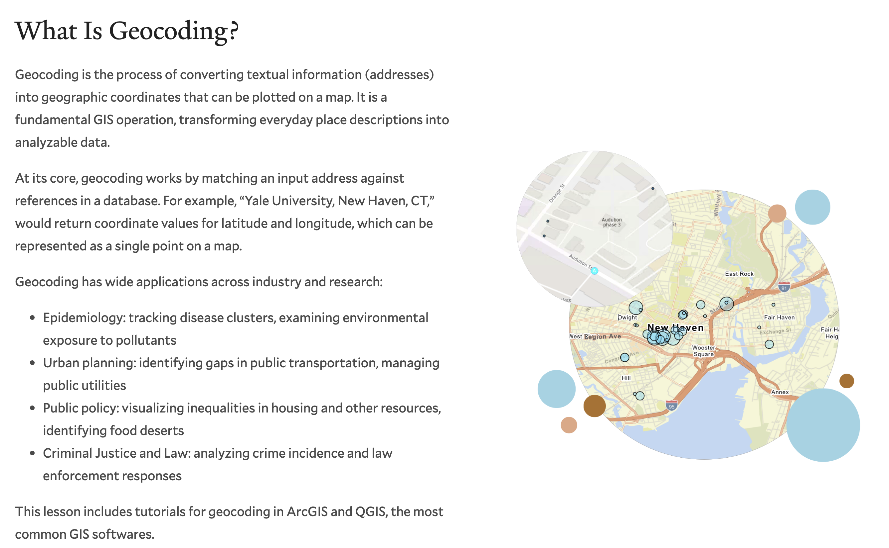
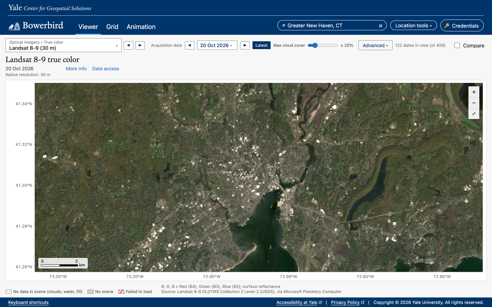

---
# try also 'default' to start simple
theme: seriph
# random image from a curated Unsplash collection by Anthony
# like them? see https://unsplash.com/collections/94734566/slidev
# background: https://cover.sli.dev
# some information about your slides (markdown enabled)
title: From the ivory tower to the city block
info: |
    Presented by Alexey Shiklomanov on behalf of Yale Center for Geospatial Solutions
# apply UnoCSS classes to the current slide
class: text-center
# https://sli.dev/features/drawing
drawings:
  persist: false
# slide transition: https://sli.dev/guide/animations.html#slide-transitions
transition: fade-out
# enable Comark Syntax: https://comark.dev/syntax/markdown
comark: true
---

# From the ivory tower to the city block

How can the Yale Center for Geospatial Solutions help New Haven decision makers?

Alexey N. Shiklomanov · Research Software Engineer 
Yale Center for Geospatial Solutions 
New Haven GIS day · November 16, 2026

<!--
The last comment block of each slide will be treated as slide notes. It will be visible and editable in Presenter Mode along with the slide. [Read more in the docs](https://sli.dev/guide/syntax.html#notes)
-->

---

# Outline

<ol>

<v-click><li>
Our portfolio
</li>
</v-click>

<v-click><li>
What we showed you
</li>
</v-click>

<v-click><li>
What (some of) you told us (or, at least, what we heard)
</li>
</v-click>

<v-click><li>
Where we think we should go next
</li></v-click>

<v-click><li>
<b>What do you think?</b>
</li></v-click>
</ol>

---
layout: center
clicks: 5
---

# Our work

  <ul class="text-2xl space-y-4">
    <li :class="$clicks < 1 ? 'hidden-item' : $clicks === 1 ? '' : 'faded'">Cartography</li>
    <li :class="$clicks < 2 ? 'hidden-item' : $clicks === 2 ? '' : 'faded'">Geospatial analysis</li>
    <li :class="$clicks < 3 ? 'hidden-item' : $clicks === 3 ? '' : 'faded'">Operational support</li>
    <li :class="$clicks < 4 ? 'hidden-item' : $clicks === 4 ? '' : 'faded'">Tutorials and resources</li>
    <li class="list-none" :class="$clicks < 5 ? 'hidden-item' : ''">...and more!</li>
  </ul>
  

    
    
    
    = 4 }">
  

---

# What does New Haven "look like" from above?

  

<a href="https://d3eu3eflreofpm.cloudfront.net/" style="">Link</a>

---
title: Bowerbird introduction
layout: iframe
url: https://d3eu3eflreofpm.cloudfront.net/
---

<!--

CT ortho; Wilbur Cross High School

CT ortho / NAIP / Planet (API key from Bitwarden); Science hill parking contruction

OSM vs. Landsat thermal; 5 May 2026. High of 66. But some buildings are very hot! A few places in New Haven get very hot!

OSM vs. Hillshade. Steps of the Sterling library.

-->

---
layout: two-cols-header
---

# What we heard from you

::left::

About our tool:
<v-click>

- High resolution is all that matters. Even 30m is useless, let alone >=100m.

</v-click>
<v-click>

- We don't need a viewer; we need the data to integrate into our workflow.

</v-click>
<v-click>

- This is disconnected from spatial units relevant to us (e.g., census tracts; property lines; zoning polygns)
</v-click>
<v-click>

- This is missing information we need (e.g., underground infrastructure; tax information)
</v-click>

::right::

<v-click>

About other stuff:

</v-click>
<v-click>

- A lot of our data aren't spatial (yet), so we can't do any GIS on them.
</v-click>
<v-click>

- We know there's a lot of data out there, but we don't know where to find it or how to use it.
</v-click>

---

# How can we help?

<v-clicks>

- **High resolution imagery**: What the options are and how to access and work with them

- **API data access**: REST APIs following OGC (or other) standards to get the data into your workflows

- **Pre-processed data products**: Curated datasets already aggregated to parcels, neighborhoods, etc.

- **Data guide**: Documentation; structured decision guide; AI chatbot?

- **Catalog of "human" data**: Curated catalog of parcel boundaries, building footprints, zoning areas, etc.

- **Geospatial tutorials**: Guides on common or discipline-specific geospatial workflows (e.g., spatial joins; geolocation; using GIS software)

- **Access to faculty experts**: Connect you with experts in architecture, economics, public health, environment, computer science, and more.

- **Access to student workers**: Refer promising students and recent graduates for internships or positions at your organizations.
</v-clicks>

---
class: '!py-4'
---

    

      Go to <b>menti.com</b> Code: <b>6107 7873</b>
    

    <iframe sandbox='allow-popups allow-scripts allow-same-origin allow-presentation' allow='autoplay; fullscreen; encrypted-media; picture-in-picture' allowfullscreen='true' allowtransparency='true' frameborder='0' height='315' src='https://www.mentimeter.com/app/presentation/aly6aj5s9uv989ddenj6zjcenhh5y4j1/embed' style='position: absolute; top: 0; left: 0; width: 100%; height: 100%;' width='420'></iframe>

---
layout: center
---

# What do you think?

